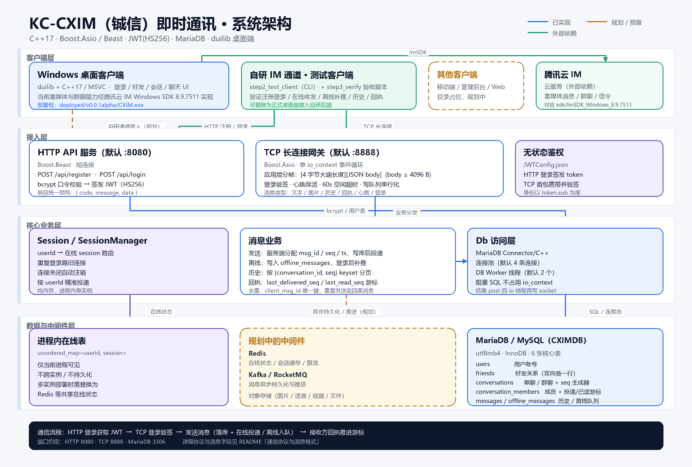

# KC-CXIM 《铖信》即时通讯


> 本项目仅供学习交流，禁止用于任何违法用途。

## 一句话定位

KC-CXIM（铖信）是一个面向学习与二次开发的全栈即时通讯项目：自带 **C++17 自研 IM 服务端**（HTTP 鉴权 + TCP 长连接 + MariaDB）与 **Windows 桌面客户端**，同时保留腾讯云 IM SDK 的接入示例。

## 功能特性

> 状态说明：**已支持** = 当前代码可直接运行；**预留** = 协议或表结构已留好位置，尚未完整实现；**规划中** = 仅在路线图中。

### 消息类型

| 消息类型 | 自研后端 | Windows 桌面端（腾讯云 IM SDK） |
| --- | --- | --- |
| 文本消息 | 已支持（`type=1`） | 已接入 |
| 图片消息 | 预留（`type=2`，`content` 存 URL） | SDK 支持，待 UI 接入 |
| 语音消息 | 规划中 | SDK 支持，待 UI 接入 |
| 视频消息 | 规划中 | SDK 支持，待 UI 接入 |
| 文件消息 | 规划中 | SDK 支持，待 UI 接入 |
| 自定义消息 | 规划中 | SDK 支持，待 UI 接入 |

### 会话形态

| 会话能力 | 状态 | 说明 |
| --- | --- | --- |
| 单聊 | 已支持 | `conversations.type=1`，按 `dedup_key` 复用同一会话 |
| 群聊 | 表结构预留 | `conversations.type=2` 已预留，群成员/群管理 API 规划中 |
| 频道 / 房间 | 规划中 | 当前未实现 |
| 万人群 | 规划中 | 需要扩散写、读扩散与消息队列支撑 |

### 实时能力

| 能力 | 状态 | 说明 |
| --- | --- | --- |
| 在线状态 | 已支持 | 进程内 `SessionManager` 维护 `userId -> session` |
| 正在输入 | 规划中 | 暂无 typing 消息类型 |
| 已读回执 | 已支持 | `conversation_members.last_read_seq` 游标 |
| 投递回执 | 已支持 | `last_delivered_seq` 游标与 `Ack` 消息 |
| 消息撤回 | 规划中 | 腾讯云 IM SDK 侧具备能力，自研后端尚未实现 |
| 离线消息 | 已支持 | `offline_messages` 队列，登录后补推 |
| 历史消息 | 已支持 | 按 `(conversation_id, seq)` keyset 分页 |
| 心跳保活 | 已支持 | 应用层 `Heartbeat` + 60 秒空闲超时 |
| 消息去重 | 已支持 | `(conversation_id, sender_id, client_msg_id)` 唯一键 |
| 断线重连 | 客户端规划中 | 服务端支持重新登录并补推离线消息 |

### 音视频能力

| 能力 | 状态 | 说明 |
| --- | --- | --- |
| WebRTC 音视频 | 未实现 | 自研后端不包含 RTC 媒体服务 |
| 信令通话 | 依赖外部 SDK | 腾讯云 IM SDK 提供信令能力，自研后端未实现 |
| 流媒体服务器 | 规划中 | 后续可接入独立 RTC / 流媒体服务 |

### 多端与同步

| 能力 | 状态 | 说明 |
| --- | --- | --- |
| Windows 桌面端 | 已支持 | duilib + C++17，源码位于 `dev/Desktop` |
| 移动端 / 管理后台 / Web | 规划中 | `dev/Mobile`、`dev/Admin` 当前为占位目录 |
| 多设备同时在线 | 未支持 | 同一账号重复登录会踢掉旧连接 |
| 多端消息漫游 | 部分支持 | 消息落库 + 离线补推 + 历史分页，跨端实时同步规划中 |

## 技术栈与架构

### 技术栈

| 层次 | 技术选型 |
| --- | --- |
| 服务端语言 | C++17 |
| 网络与 HTTP | Boost.Asio（TCP 长连接）、Boost.Beast（HTTP 短连接） |
| 序列化 | RapidJSON（消息体 JSON）、自定义 4 字节长度分帧 |
| 鉴权与安全 | JWT HS256（jwt-cpp）、bcrypt（libbcrypt）、OpenSSL |
| 数据库 | MariaDB 10.x / MySQL 8.x + MariaDB Connector/C++ |
| 构建与依赖 | CMake、MSVC / GCC、vcpkg（OpenSSL） |
| 桌面客户端 | duilib、C++17、spdlog、腾讯云 IM Windows SDK 8.9.7511 |
| 存储与中间件 | MariaDB 6 张核心表；进程内在线表；Redis / Kafka / 对象存储为规划项 |

### 架构图



### 架构说明

项目当前采用“双通道、可演进”的结构：

1. **自研 IM 通道（测试客户端已接入，桌面端规划接入）**：通过 HTTP 完成注册/登录并获取 JWT，再通过 TCP 长连接完成鉴权、心跳、消息收发、历史拉取与回执。
2. **腾讯云 IM 通道**：Windows 桌面端当前通过 `ImSDK.dll` 接入腾讯云 IM，用于验证富媒体、群聊、信令等能力；后续可逐步替换为自研通道。
3. **服务端分层**：`Session` 负责单连接生命周期，`SessionManager` 负责在线路由，消息业务负责落库、投递、离线补推、历史与回执，`Db` 层用连接池 + Worker 线程隔离阻塞 SQL。
4. **数据层**：MariaDB 保存用户、好友、会话、成员游标、消息历史与离线队列；在线状态暂存在进程内，多实例部署时需要替换为 Redis 等共享存储。

更详细的 TCP 选型分析见 [`docs/KC-CXIM-IMS-DESIGN.md`](docs/KC-CXIM-IMS-DESIGN.md)。

### 项目结构

```text
KC-CXIM/
├── dev/
│   ├── IMS/KC-CXIM-Svc/basic_service_20261107/   # 自研 IM 服务端
│   │   ├── step1_tcp_echo/                       # TCP/HTTP 服务主体
│   │   ├── step2_test_client/                    # CLI 测试客户端
│   │   ├── step3_verify/                         # 粘包/半包与业务验收脚本
│   │   └── db/schema.sql                         # MariaDB 表结构
│   ├── Desktop/KC_CXIM_Desktop/                  # Windows 桌面客户端
│   ├── Admin/                                    # 管理后台（占位）
│   └── Mobile/                                   # 移动端（占位）
├── docs/
│   ├── architecture.png                          # 系统架构图
│   ├── KC-CXIM-IMS-DESIGN.md                     # TCP/WebSocket 选型说明
│   └── TIM_USAGE.md                              # 腾讯云 IM SDK 使用说明
├── sdk/                                          # 第三方 SDK 与依赖参考
└── LICENSE
```

## 快速开始

以下步骤以 Windows + Git Bash 为主，服务端同时支持 Ubuntu / Debian。

### 环境要求

| 依赖 | 版本 / 说明 |
| --- | --- |
| 操作系统 | Windows 10/11；服务端也可运行在 Ubuntu / Debian |
| 编译工具 | Visual Studio 2022（MSVC）或 GCC |
| CMake | 服务端 >= 3.16，桌面端 >= 3.18 |
| Boost | 1.92（仓库 `sdk/boost_1_92_0-bin-msvc-all-32-64`） |
| MariaDB / MySQL | MariaDB 10.x 或 MySQL 8.x |
| MariaDB Connector/C++ | Windows 64 位版本 |
| vcpkg | 用于安装 OpenSSL |
| Python | 3.x，用于运行验收脚本 |
| 腾讯云 IM SDK | 可选，桌面端已附带 `ImSDK.dll` |

### 1. 克隆仓库

```bash
git clone https://github.com/fingerecho/KC-CXIM.git
cd KC-CXIM
```

### 2. 配置数据库

进入服务端目录并复制配置模板：

```bash
cd dev/IMS/KC-CXIM-Svc/basic_service_20261107
cp DBConfig.ini.example DBConfig.ini
```

按实际环境修改 `DBConfig.ini`：

```ini
[db]
host=127.0.0.1
port=3306
dbname=CXIMDB
user=devuser
password=devpass
```

**Ubuntu / Debian** 可以直接使用脚本自动安装并初始化 MariaDB：

```bash
sudo bash prepare_env_V0.sh
```

脚本会读取 `DBConfig.ini`，创建数据库、业务账号，并自动导入 `db/schema.sql`。

**Windows** 可手动建库建表：

```bash
mysql -u root -p < db/schema.sql
mysql -u root -p -e "CREATE USER IF NOT EXISTS 'devuser'@'%' IDENTIFIED BY 'devpass'; GRANT ALL PRIVILEGES ON CXIMDB.* TO 'devuser'@'%'; FLUSH PRIVILEGES;"
```

### 3. 配置 JWT

```bash
cp JWTConfig.json.example JWTConfig.json
python -c "import secrets; print(secrets.token_hex(32))"
```

把输出填入 `JWTConfig.json` 的 `jwt_secret`，并设置 `jwt_issuer`：

```json
{
  "jwt_secret": "把生成的 64 位十六进制字符串粘贴到这里",
  "jwt_issuer": "kc-cxim"
}
```

> `DBConfig.ini` 与 `JWTConfig.json` 含敏感信息，已在 `.gitignore` 中忽略，请勿提交到仓库。

### 4. 编译服务端

Windows（Git Bash）：

```bash
cd dev/IMS/KC-CXIM-Svc/basic_service_20261107
export BOOST_ROOT="D:/FKC/KC-CXIM/sdk/boost_1_92_0-bin-msvc-all-32-64/boost_1_92_0"
bash prepare_dev_env.sh
bash build_step.sh
```

也可以手动指定依赖路径：

```bash
cmake -S . -B build \
  -DBOOST_ROOT="<Boost 根目录>" \
  -DMariaDB_include="<MariaDB Connector>/include" \
  -DMariaDB_lib="<MariaDB Connector>/lib" \
  -DOPENSSL_ROOT_DIR="<vcpkg>/installed/x64-windows"
cmake --build build --config Debug -j
```

> `build_step.sh` 中的 Boost 与 MariaDB Connector 路径是示例路径，请根据本机安装位置调整。

Linux：

```bash
cd dev/IMS/KC-CXIM-Svc/basic_service_20261107
sudo bash prepare_dev_env.sh
bash build_step.sh
```

编译产物：

- Windows：`build/bin/Debug/tcp_echo_server.exe`
- Linux：`build/bin/tcp_echo_server`

### 5. 启动服务端

```bash
# 用法：tcp_echo_server [TCP 端口] [DBConfig.ini 路径] [HTTP 端口]
./build/bin/Debug/tcp_echo_server.exe 8888 DBConfig.ini 8080
```

Linux：

```bash
./build/bin/tcp_echo_server 8888 DBConfig.ini 8080
```

也可以使用环境变量：

```bash
DB_CONFIG=./DBConfig.ini JWT_CONFIG=./JWTConfig.json HTTP_PORT=8080 \
  ./build/bin/tcp_echo_server 8888
```

启动成功后应看到类似输出：

```text
[db] connecting to 127.0.0.1:3306/CXIMDB as devuser
[tcp] listening on port 8888
[http] listening on port 8080
```

### 6. 验证服务

先验证 HTTP 注册与登录：

```bash
curl -s http://127.0.0.1:8080/api/register \
  -H "Content-Type: application/json" \
  -d '{"username":"alice","password":"secret123"}'

curl -s http://127.0.0.1:8080/api/login \
  -H "Content-Type: application/json" \
  -d '{"username":"alice","password":"secret123"}'
```

登录成功会返回 `data.token`，该 token 用于 TCP 登录。

运行完整验收脚本（自动启动服务端，覆盖注册、登录、在线收发、离线补推、回执）：

```bash
bash step3_verify/verify_tcp_http.sh 8888 "$(pwd)/build" 8080
```

期望输出：

```text
[verify] ALL PASS
```

### 7. 运行 Windows 桌面客户端

最快方式：直接运行已部署版本。

```bash
cd dev/Desktop/KC_CXIM_Desktop/deployed/v0.0.1alpha
./CXIM.exe
```

测试账号：`fingerecho0`、`fingerecho1`、`fingerecho2`，密码可填任意值。

从源码构建：使用 Visual Studio 2022 打开 `dev/Desktop/KC_CXIM_Desktop/CXIM/CXIM.slnx`，选择 `x64` 配置编译；或使用 CMake 构建（需要 duilib、vcpkg 与 ImSDK 依赖）。

### 配置项说明

| 配置 | 位置 | 说明 |
| --- | --- | --- |
| `DBConfig.ini` | 服务端根目录 | 数据库地址、端口、库名、账号、密码 |
| `JWTConfig.json` | 服务端根目录 | JWT 密钥与签发者 |
| `DB_CONFIG` | 环境变量 | 覆盖 `DBConfig.ini` 路径 |
| `JWT_CONFIG` | 环境变量 | 覆盖 `JWTConfig.json` 路径 |
| `HTTP_PORT` | 环境变量 | 覆盖 HTTP 端口 |
| TCP 端口 | 命令行第 1 个参数 | 默认 `8888` |
| HTTP 端口 | 命令行第 3 个参数 | 默认 `8080` |
| `CXIMAppConfig.h` | 桌面端源码 | 腾讯云 IM SDK 的 `TIM_SDK_APPID` / `TIM_SDK_APPKEY`，请替换为自己的配置 |
| `ImSDK.dll` | 桌面端运行目录 | 腾讯云 IM SDK 动态库，需与 `CXIM.exe` 放在同一目录 |

## 通信协议与消息格式

### HTTP 接口（默认 `:8080`）

| 方法 | 路径 | 请求体 | 成功响应 |
| --- | --- | --- | --- |
| POST | `/api/register` | `{"username":"alice","password":"secret123"}` | `{"code":0,"message":"ok","data":{"userId":1}}` |
| POST | `/api/login` | `{"username":"alice","password":"secret123"}` | `{"code":0,"message":"ok","data":{"userId":1,"username":"alice","token":"<JWT>"}}` |

约定：

- `code=0` 表示成功，非 0 表示失败。
- 密码长度 6–72 字节，用户名长度不超过 64 字节。
- 注册/登录只接受 `POST`，其他方法返回 `405`。
- 口令使用 bcrypt 哈希后存入 `users.password_hash`，不会保存明文。

### TCP 帧格式（默认 `:8888`）

TCP 是字节流，项目采用固定长度头解决粘包/半包：

```text
+----------------------+----------------------------------+
| 4 字节长度 len       | len 字节的 JSON 消息体           |
| （大端 / 网络字节序）| 单条 body 上限 4096 字节         |
+----------------------+----------------------------------+
```

- 发送方：`len = body.size()`，用 `htonl` 转成网络字节序写入头部。
- 接收方：先精确读取 4 字节，用 `ntohl` 还原长度，再读取对应长度的 body。
- 心跳：客户端定期发送 `Heartbeat`，服务端 60 秒收不到任何消息会关闭连接。

### 消息 JSON 字段

| 字段 | 类型 | 说明 |
| --- | --- | --- |
| `from` | uint64 | 发送者 `userId`；客户端发送时服务端不信任该字段，以 JWT 身份为准 |
| `to` | uint64 | 接收者 `userId`；登录/心跳时可为 `0` |
| `type` | int | 消息类型，见下表 |
| `msg_id` | uint64 | 发送时为客户端临时消息号，服务端下发时为服务端消息 ID |
| `ts` | uint64 | 毫秒时间戳，服务端生成 |
| `conversation_id` | uint64 | 会话 ID，服务端下发或回执时使用 |
| `seq` | uint64 | 会话内单调递增序号；历史请求时表示 `before_seq` |
| `content` | string | 文本、图片 URL、JWT、历史 JSON 数组等 |

### 消息类型

| 值 | 类型 | 方向 | content 含义 |
| --- | --- | --- | --- |
| 1 | `Text` | 双向 | 文本正文 |
| 2 | `Image` | 双向 | 图片 URL，不建议传 base64 原始二进制 |
| 3 | `Heartbeat` | 客户端 → 服务端 | 心跳保活，可为空 |
| 100 | `Login` | 客户端 → 服务端 | HTTP 登录后签发的 JWT |
| 101 | `LoginAck` | 服务端 → 客户端 | 登录成功回执 |
| 102 | `Error` | 服务端 → 客户端 | 错误提示 |
| 110 | `HistoryReq` | 客户端 → 服务端 | 历史条数（如 `"20"`），`seq` 为 `before_seq` |
| 111 | `HistoryResp` | 服务端 → 客户端 | JSON 数组字符串，见 `serialize_history` |
| 112 | `Ack` | 客户端 → 服务端 | 回执；`"delivered"` 只确认投递，否则推进已读 |
| 113 | `SendAck` | 服务端 → 客户端 | 发送成功确认，携带服务端分配的 `msg_id/seq/ts` |

### 交互示例

HTTP 登录拿到 JWT 后，建立 TCP 连接并发送登录消息：

```json
{"from":1,"to":0,"type":100,"content":"<JWT>"}
```

发送一条文本消息：

```json
{"from":0,"to":2,"type":1,"msg_id":1,"content":"hello"}
```

服务端返回发送确认：

```json
{"from":0,"to":1,"type":113,"msg_id":10,"seq":10,"ts":1760000000000,"conversation_id":1,"content":"sent"}
```

接收方回执：

```json
{"from":0,"to":0,"type":112,"conversation_id":1,"seq":10,"content":"delivered"}
```

拉取历史消息（最新 20 条）：

```json
{"from":0,"to":2,"type":110,"seq":0,"content":"20"}
```

服务端处理顺序：

1. HTTP 登录校验 bcrypt 口令并签发 JWT。
2. TCP 首包 `Login` 验签，绑定 `userId` 与当前连接。
3. 发送消息时服务端分配 `msg_id/seq/ts` 并落库。
4. 接收方在线则直接投递，离线则写入 `offline_messages`。
5. 接收方上线后补推离线消息，收到 `Ack` 后推进游标并删除队列。
6. 历史消息按 `conversation_id + seq` 做 keyset 分页，避免深分页性能问题。

## 贡献指南

欢迎提交 Issue 与 Pull Request。

### 提交 Issue

- 先搜索是否已有相同问题。
- 说明运行环境（操作系统、编译器、MariaDB 版本、依赖版本）。
- 提供可复现步骤、期望结果、实际结果与相关日志。
- 涉及协议或数据库时，请附上请求/响应示例或表结构变更说明。

Issue 地址：<https://github.com/fingerecho/KC-CXIM/issues>

### 提交 Pull Request

1. Fork 仓库并从 `main` 创建分支，例如 `feature/group-chat`。
2. 保持提交聚焦，一个 PR 只做一件事，提交信息使用清晰的祈使句。
3. 提交前至少完成：
   ```bash
   bash build_step.sh
   bash step3_verify/verify_tcp_http.sh 8888 "$(pwd)/build" 8080
   ```
4. 不要提交 `DBConfig.ini`、`JWTConfig.json`、构建产物或任何密钥。
5. 修改协议、表结构或配置项时，同步更新 `readme.md` 与相关文档。

当前仓库暂无独立的 `CONTRIBUTING.md`，以上约定即为贡献流程；后续如有需要可单独拆分。

当前仓库的待办事项： [`docs/TODO-LIST.md`](docs/TODO-LIST.md)

## 许可证

本项目采用 [MIT License](LICENSE)。

```text
MIT License

Copyright (c) 2026 方克铖
```

你可以自由使用、修改、分发本项目，但需保留原始版权声明与许可声明。本项目仅供学习交流，禁止用于任何违法用途。
