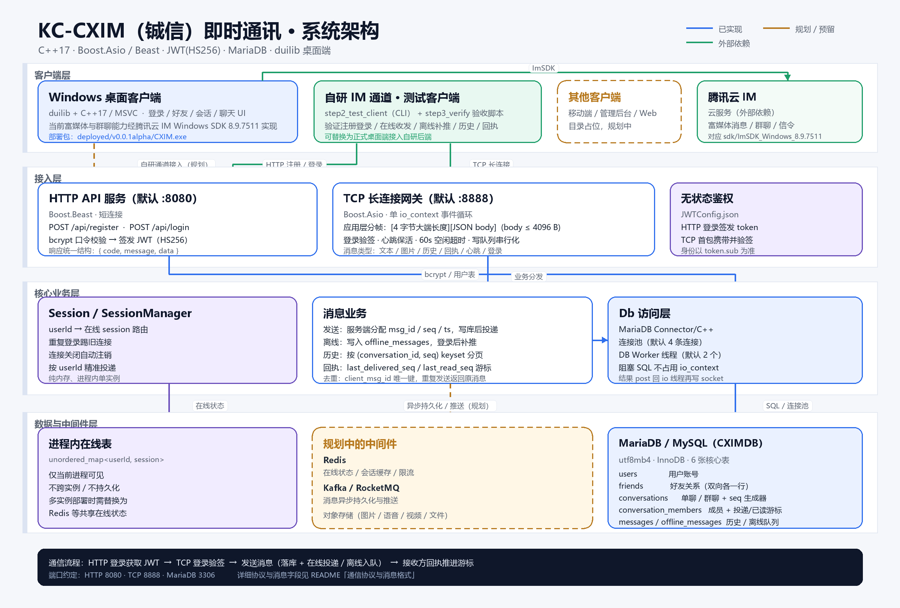

# KC-CXIM 《铖信》即时通讯


> 本项目仅供学习交流，禁止用于任何违法用途。

## 一句话定位

**KC-CXIM《铖信》** 是一个为低配服务器优化的全栈即时通讯项目，目标是在 **2 核 CPU**、**2GB 内存**、**3Mbps 带宽** 的入门级云服务器上跑通“注册/登录 → 好友关系 → 单聊消息 → 群聊消息 → 在线推送”的完整链路，同时提供 Windows 桌面端(Duilib/Qt6) 、微信小程序（私有 TCP 版）、Android端(Java)和 Web 管理后台（Drogon + Vue3）。

### 适用场景

- **个人开发者**学习 IM 服务端架构
- **小型团队**内部通信
- **教学演示**
- **边缘节点**或预算极低的部署环境

### 不适用场景
- **大规模公网 IM**（数万在线、每秒数千消息、超大群广播）
- 需要**多机房容灾**或**强一致消息队列**的场景

| 上述场景应选择 **OpenIM**、**腾讯云 IM** 等经过大规模验证的方案。

### 技术架构

服务端采用 **C++17 + Boost.Asio 单 io_context 多线程模型**，**HTTP 鉴权**与 **TCP 长连接**共享同一事件循环；数据库层使用 **MariaDB + 按需扩容连接池**，避免启动时连接风暴；协议层为**轻量私有 TCP 帧**，不引入 **Kafka**、**Redis 集群**等重型中间件。

群聊功能同样按低配约束设计：

- **群成员关系**与**消息落库**走 **MariaDB**
- **群消息推送**复用与单聊相同的 **SessionManager 在线表**
- 按“**在线成员才推送、离线成员走拉取**”的策略减少广播放大
- **群规模**与**同时在线群数**在文档中给出建议上限，避免在 **2 核 2GB** 下出现消息风暴

这些选择都是为了把有限的 **CPU**、**内存**和**带宽**留给业务本身。

### 功能链路

- **注册/登录**（HTTP + JWT）
- **好友申请与通过**
- **单聊消息**（TCP 长连接，带 ACK 与离线补投）
- **群创建/加群/退群**
- **群消息收发**（在线推送 + 离线拉取）
- **好友/群列表查询**
- **删除好友/退群/群解散**

**Windows 桌面端**、**微信小程序**共享同一套服务端接口。

## 功能特性

> 状态说明：**已支持** = 当前代码可直接运行；**预留** = 协议或表结构已留好位置，尚未完整实现；**规划中** = 仅在路线图中。

### 消息类型

| 消息类型 | 自研后端 | Windows 桌面端（腾讯云 IM SDK） |
| --- | --- | --- |
| 文本消息 | 已支持（`type=1`） | 已接入 |
| 图片消息 | 已支持（`type=2`，`content` 存 URL） | 已接入 |
| 语音消息 | 规划中 | SDK 支持，待 UI 接入 |
| 视频消息 | 规划中 | SDK 支持，待 UI 接入 |
| 文件消息 | 已支持 | 已接入 |
| 自定义消息 | 规划中 | SDK 支持，待 UI 接入 |

### 会话形态

| 会话能力 | 状态 | 说明 |
| --- | --- | --- |
| 单聊 | 已支持 | `conversations.type=1`，按 `dedup_key` 复用同一会话 |
| 群聊 | 表结构预留 | `conversations.type=2` 已预留，群成员/群管理 API 规划中 |
| 频道 / 房间 | 规划中 | 当前未实现 |
| 万人群 | 规划中 | 需要扩散写、读扩散与消息队列支撑 |

### 实时能力

| 能力 | 状态 | 说明 |
| --- | --- | --- |
| 在线状态 | 已支持 | 进程内 `SessionManager` 维护 `userId -> session` |
| 正在输入 | 规划中 | 暂无 typing 消息类型 |
| 已读回执 | 已支持 | `conversation_members.last_read_seq` 游标 |
| 投递回执 | 已支持 | `last_delivered_seq` 游标与 `Ack` 消息 |
| 消息撤回 | 规划中 | 腾讯云 IM SDK 侧具备能力，自研后端尚未实现 |
| 离线消息 | 已支持 | `offline_messages` 队列，登录后补推 |
| 历史消息 | 已支持 | 按 `(conversation_id, seq)` keyset 分页 |
| 心跳保活 | 已支持 | 应用层 `Heartbeat` + 60 秒空闲超时 |
| 消息去重 | 已支持 | `(conversation_id, sender_id, client_msg_id)` 唯一键 |
| 断线重连 | 已支持 | 服务端支持重新登录并补推离线消息 |

### 音视频能力

| 能力 | 状态 | 说明 |
| --- | --- | --- |
| WebRTC 音视频 | 未实现 | 自研后端不包含 RTC 媒体服务 |
| 信令通话 | 依赖外部 SDK | 腾讯云 IM SDK 提供信令能力，自研后端未实现 |
| 流媒体服务器 | 规划中 | 后续可接入独立 RTC / 流媒体服务 |

### 多端与同步

| 能力 | 状态 | 说明 |
| --- | --- | --- |
| Windows 桌面端 | 已支持 | duilib + C++17，源码位于 `dev/Desktop` |
| 管理后台 | 已支持 | Drogon + Vue3 ，源码位于 `dev/Admin` |
| 移动端 / Web | 规划中 | `dev/Mobile`当前为占位目录 |
| 多设备同时在线 | 未支持 | 同一账号重复登录会踢掉旧连接 |
| 多端消息漫游 | 部分支持 | 消息落库 + 离线补推 + 历史分页，跨端实时同步规划中 |

## 技术栈与架构

### 技术栈

| 层次 | 技术选型 |
| --- | --- |
| 服务端语言 | C++17 |
| 网络与 HTTP | Boost.Asio（TCP 长连接）、Boost.Beast（HTTP 短连接） |
| 序列化 | RapidJSON（消息体 JSON）、自定义 4 字节长度分帧 |
| 鉴权与安全 | JWT HS256（jwt-cpp）、bcrypt（libbcrypt）、OpenSSL |
| 数据库 | MariaDB 11.8.6 + MariaDB Connector/C++ |
| 构建与依赖 | CMake、MSVC / GCC、vcpkg（OpenSSL） |
| 桌面客户端 | duilib、C++17、spdlog、腾讯云 IM Windows SDK 8.9.7511 |
| 存储与中间件 | MariaDB 10 张核心表；进程内在线表；Redis / Kafka / 对象存储为规划项 |

### 架构图



### 架构说明

项目当前采用“双通道、可演进”的结构：

1. **自研 IM 通道（桌面端、小程序端接入）**：通过 HTTP 完成注册/登录并获取 JWT，再通过 TCP 长连接完成鉴权、心跳、消息收发、历史拉取与回执。
2. **腾讯云 IM 通道**：Windows 桌面端当前通过 `ImSDK.dll` 接入腾讯云 IM，用于验证富媒体、群聊、信令等能力；后续可逐步替换为自研通道。
3. **服务端分层**：`Session` 负责单连接生命周期，`SessionManager` 负责在线路由，消息业务负责落库、投递、离线补推、历史与回执，`Db` 层用连接池 + Worker 线程隔离阻塞 SQL。
4. **数据层**：MariaDB 保存用户、好友、会话、成员游标、消息历史与离线队列；在线状态暂存在进程内，多实例部署时需要替换为 Redis 等共享存储。

更详细的 TCP 选型分析见 [`docs/KC-CXIM-IMS-DESIGN.md`](docs/KC-CXIM-IMS-DESIGN.md)。

## 通信协议

项目当前通信协议见 [`docs\IMS_communication_protocol.md`](docs\IMS_communication_protocol.md)。

## 贡献指南

欢迎提交 Issue 与 Pull Request。

### 提交 Issue

- 先搜索是否已有相同问题。
- 说明运行环境（操作系统、编译器、MariaDB 版本、依赖版本）。
- 提供可复现步骤、期望结果、实际结果与相关日志。
- 涉及协议或数据库时，请附上请求/响应示例或表结构变更说明。

Issue 地址：<https://github.com/fingerecho/KC-CXIM/issues>

### 提交 Pull Request

1. Fork 仓库并从 `main` 创建分支，例如 `feature/group-chat`。
2. 保持提交聚焦，一个 PR 只做一件事，提交信息使用清晰的祈使句。
3. 提交前至少完成：
   ```bash
   bash build.sh
   bash step3_verify/verify_tcp_http.sh 8888 "$(pwd)/build" 8080
   ```
4. 不要提交 `DBConfig.ini`、`JWTConfig.json`、`QiniuConfig.json`构建产物或任何密钥。
5. 修改协议、表结构或配置项时，同步更新 `readme.md` 与相关文档。

当前仓库暂无独立的 `CONTRIBUTING.md`，以上约定即为贡献流程；后续如有需要可单独拆分。

当前仓库的待办事项： [`docs/TODO-LIST.md`](docs/TODO-LIST.md)

## 许可证

本项目采用 [MIT License](LICENSE)。

```text
MIT License

Copyright (c) 2026 方克铖
```

你可以自由使用、修改、分发本项目，但需保留原始版权声明与许可声明。本项目仅供学习交流，禁止用于任何违法用途。
